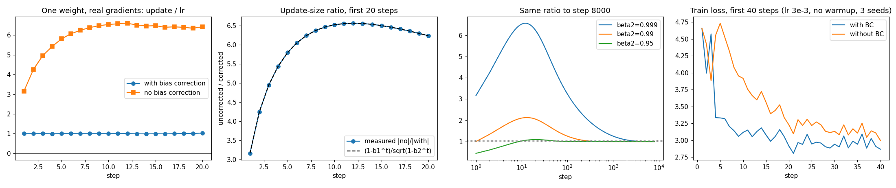
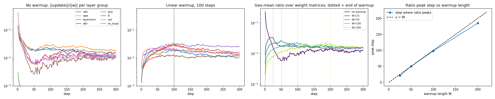
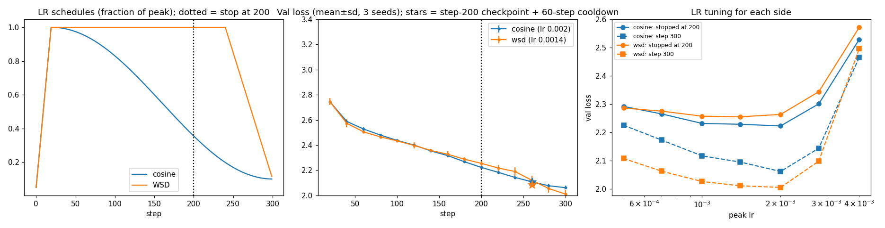
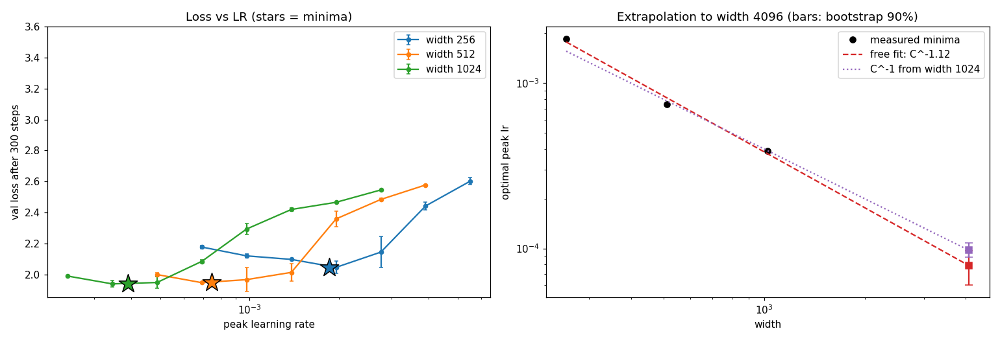

# Adam, warmup, schedules and learning-rate scaling — by hand and by measurement

Model for everything here: pre-LN GPT, 4 layers, **width C** (heads = C/64, min 4), vocab 96, T=128, batch 16, char-level on 3 MB of Python stdlib source, standard parameterisation (GPT-2 init, std 0.02), bf16 autocast with fp32 master weights and fp32 Adam state, grad-clip 1.0. Hardware: RTX 3060 Laptop, PyTorch 2.10.
Adam is [written from the paper's equations](common.py) (`common.Adam`) so bias correction can be disabled and the update ratio logged; part 1 proves it equals `torch.optim.Adam`.

| script | part | log / results | figure |
|---|---|---|---|
| [`adam_by_hand.py`](adam_by_hand.py) | 1. Adam by hand vs PyTorch | `results_adam_by_hand.json` | – |
| [`bias_correction.py`](bias_correction.py) | 2. bias correction off, first 20 steps | `results_bias_correction.json` | `figs/bias_correction.png` |
| [`ratios.py`](ratios.py) | 3. update-to-weight ratio, warmup | `results_ratios.json` | `figs/ratios.png` |
| [`schedules.py`](schedules.py) | 4. cosine vs WSD, stopped at 200 | `schedules.log`, `results_schedules.json` | `figs/schedules.png` |
| [`lr_sweep.py`](lr_sweep.py) | 5. LR sweep at widths 256/512/1024 | `sweep.log`, `results_lr_sweep.json` | `figs/lr_sweep.png` |

```bash
python adam_by_hand.py && python bias_correction.py && python ratios.py && python schedules.py && python lr_sweep.py   # ~35 min on a laptop GPU
```

---

## 1. Adam by hand, checked against PyTorch

One weight `w0 = 1.0`, gradients `[0.5, −0.3, 0.8, 0.1, −0.6]`, `lr=0.01, β1=0.9, β2=0.999, ε=1e-8`. With `m_t = β1 m + (1−β1) g`, `v_t = β2 v + (1−β2) g²`, `m̂ = m/(1−β1^t)`, `v̂ = v/(1−β2^t)`, `step = lr·m̂/(√v̂ + ε)`, `w ← w − step`.
Step 1 worked out on paper: `m = 0.05`, `v = 0.001·0.25 = 2.5e-4`, `m̂ = 0.05/0.1 = 0.5`, `v̂ = 2.5e-4/0.001 = 0.25`, `step = 0.01·0.5/0.5 = 0.01` (minus ε: 0.0099999998), `w = 0.9900000002`.

| t | g | m | v | m̂ | v̂ | step | w |
|---|---|---|---|---|---|---|---|
| 1 | 0.5 | 0.0500000000 | 2.5000e-4 | 0.5000000000 | 0.2500000000 | 0.0099999998 | 0.9900000002 |
| 2 | −0.3 | 0.0150000000 | 3.3975e-4 | 0.0789473684 | 0.1699599800 | 0.0019149803 | 0.9880850199 |
| 3 | 0.8 | 0.0935000000 | 9.7941e-4 | 0.3450184502 | 0.3267967712 | 0.0060353635 | 0.9820496564 |
| 4 | 0.1 | 0.0941500000 | 9.8843e-4 | 0.2737714452 | 0.2474786805 | 0.0055032500 | 0.9765464063 |
| 5 | −0.6 | 0.0247350000 | 1.3474e-3 | 0.0604014554 | 0.2700279980 | 0.0011623663 | 0.9753840401 |

PyTorch (`torch.optim.Adam`, float64 parameter; m and v read from `opt.state`, m̂, v̂ computed from them) gives the same ten digits. Max |hand − torch| over all five steps: **m 0, v 0, m̂ 0, v̂ 0, step 4e-17, w 0**. In float32 the final weight differs from the float64 hand value by 1.6e-8 (rounding). My `common.Adam` equals the hand value exactly (0.0), and over 10 steps of the full transformer it matches `torch.optim.Adam` to 2.7e-7 in the parameters (fp32 summation order).

## 2. Bias correction off: first twenty steps, and when it stops mattering



Without correction the update is `m/(√v+ε)` instead of `(m/c₁)/(√(v/c₂)+ε)` with `c₁ = 1−β1^t`, `c₂ = 1−β2^t`. So **uncorrected/corrected = c₁/√c₂**, an exact identity independent of the gradients (ε→0); panel 2 shows the measured ratio on real gradients of `fc.weight[7,11]` landing on the formula.

* t=1: **3.16×** too large; t=5: 5.8×; **peak 6.57× at t=12**; t=20: 6.24×; t=100: 3.24×; t=1000: 1.26×. Corrected update is ±1·lr (here ≈1.00) throughout.
* Why it starts too big: at t=1, m is 0.1·g but √v is only √0.001·|g| = 0.032·|g|, so m/√v is 3.16× the true value. v warms up 100× slower than m, so the error *grows* before it decays.

**Number of steps after which the difference stops mattering** (|ratio − 1| < threshold for all later steps, β1 = 0.9):

| β2 | 10% | 5% | 1% | 0.1% |
|---|---|---|---|---|
| 0.95 | 6 | 43 | 76 | 122 |
| 0.98 | 87 | 118 | 195 | 308 |
| 0.99 | 175 | 237 | 391 | 619 |
| **0.999** | 1,751 | **2,375** | **3,925** | 6,213 |

My answer for the default β2 = 0.999: **~2,400 steps for the update to be within 5%, ~3,900 within 1%**. It is ~4/(1−β2) steps, set by β2 (v's memory), not β1. Practical consequence: no bias correction is *not* harmless for any run shorter than that unless warmup covers it.

Training effect (C=256, lr 3e-3, no warmup, 3 seeds, 300 steps): train loss at step 10 is 3.12 with vs 3.92 without; **val loss after 300 steps 2.655 with vs 2.832 without**. The loss gap had not closed by step 300 — the early 6× over-step does damage that persists, which is *longer* than the update-size identity alone suggests. (A "gap < 0.05 for good" rule only triggers at step 295, i.e. never in a meaningful sense.)

## 3. Update-to-weight ratio per layer; where warmup stops changing it

`ratio = ||lr·m̂/(√v̂+ε)|| / ||w||`, logged for **every parameter tensor at every step** (3 seeds averaged; peak lr 3e-3; LayerNorm biases excluded — they start at exactly 0, ratio undefined).



| layer group | no warmup, t=1 | t=20 | t=100 | warmup 100: t=1 | t=50 | t=100 | t=150 | t=300 |
|---|---|---|---|---|---|---|---|---|
| wte (embedding) | 0.130 | 0.036 | 0.022 | 0.0013 | 0.019 | 0.019 | 0.014 | 0.011 |
| wpe | 0.150 | 0.035 | 0.028 | 0.0015 | 0.018 | 0.029 | 0.022 | 0.013 |
| qkv (mean of 4 layers) | 0.149 | 0.027 | 0.012 | 0.0015 | 0.018 | 0.030 | 0.021 | 0.016 |
| proj | 0.424 | 0.021 | 0.010 | 0.0042 | 0.022 | 0.032 | 0.026 | 0.026 |
| fc | 0.150 | 0.016 | 0.006 | 0.0015 | 0.011 | 0.012 | 0.011 | 0.012 |
| out | 0.424 | 0.022 | 0.010 | 0.0042 | 0.022 | 0.021 | 0.017 | 0.016 |
| lm_head | 0.150 | 0.030 | 0.021 | 0.0015 | 0.014 | 0.020 | 0.019 | 0.014 |
| layernorm weights | 0.0030 | 0.0007 | 0.0004 | 0.00001 | 0.0003 | 0.0007 | 0.0007 | 0.0009 |

* **Step 1 without warmup** is `lr/σ_w`: Adam's first update has magnitude `lr` on every element whatever the gradient, so ratio = 3e-3/0.02 = **0.15** for std-0.02 matrices and 3e-3/0.0071 = **0.42** for `proj`/`out` (their init is scaled by 1/√(2L)). Every weight moves by 15–42 % of its norm on step one — that is what warmup prevents (warmup-100 starts at 0.0013–0.004).
* **The step at which warmup stops changing it.** Under warmup the ratio climbs with lr, then, once lr is constant, can only fall (Adam's normalised update shrinks as gradient noise takes over). The smoothed ratio therefore peaks where the ramp ends. Measured peak step (geometric mean over the 19 weight matrices) for warmup length W: **W=25 → 21, W=50 → 50, W=100 → 98, W=200 → 185**. So for the W=100 run **warmup stops changing the ratio at step ≈ 100** (98 measured; per-layer 97–101 for qkv/proj/fc/wpe; the token embedding, `out` and `lm_head` peak earlier, at 24–65; I did not investigate why). It tracks W with a slight lead that grows with W.
* **It is not forgotten at that step.** Median over tensors of |ratio_W/ratio_none − 1| is 0.2–0.4 at steps 200–290 for every W — a warmed-up run's update sizes stay ~20 % off the no-warmup run's for the whole 300 steps (the weights have gone to a different place, Adam's v differs). Warmup's effect on loss was large: mean train loss of the last 20 steps 2.66 (none) vs 2.25 / **2.09** / 2.11 / 2.15 for W = 25 / 50 / 100 / 200.

## 4. Cosine vs WSD, 300 steps planned, stopped at step 200

Both: 20-step linear warmup, end at 10 % of peak. **Cosine** decays over steps 20–300. **WSD** is flat at peak until step 240, then decays linearly over the last 60 (20 %). C=256, 3 seeds, paired (same init and data stream), val loss on 40 fixed held-out batches.

**Tuning both sides first.** Each schedule got its own peak-LR sweep, √2 spacing, 5e-4 … 4e-3 (selected on the step-200 loss, the thing being compared). My first pass used a coarser grid with WSD's optimum at the grid edge, so I refined it (that log is kept as `schedules_coarse_grid.log`). Tuned: **cosine 2e-3, WSD 1.4e-3**.



| each at its own tuned LR | cosine | WSD | WSD − cosine (paired; per-seed) |
|---|---|---|---|
| **stopped at step 200** | **2.2228** (sd 0.006) | **2.2550** (sd 0.023) | +0.032 (+0.053, +0.030, +0.014) |
| step 200 + 60-step linear cooldown* | 2.1085 (0.010) | 2.0866 (0.027) | −0.022 (+0.007, −0.026, −0.047) |
| run to step 300 as planned | 2.0615 (0.015) | 2.0108 (0.033) | −0.051 (−0.022, −0.058, −0.073) |

\* checkpoint at 200, then LR falls linearly from the value in force (0.36·peak for cosine, 1.0·peak for WSD) to 0.1·peak in 60 steps — the same cooldown applied to both.

**Both losses at step 200: cosine 2.223, WSD 2.255.** Cosine is lower on all three seeds, but it is at 36 % of peak LR while WSD is still at 100 %, so this compares partially annealed against un-annealed weights.

**Which I would keep: the WSD model**, with modest confidence. The raw step-200 gap is real (+0.032, 3/3 seeds) but it mostly measures where each run happens to be on its schedule. With the same 60-step cooldown applied to both checkpoints, WSD is ahead (−0.022), and at the planned end it wins clearly (−0.051, 3/3 seeds). The cooldown result is within noise (paired sd 0.027, 2 of 3 seeds, n=3), so the sound statement is "WSD is at least as good once annealed, and is the only one of the two whose checkpoint is intended to be annealed later". **If the 200-step checkpoint is itself the deliverable and nothing more can be trained, keep cosine** — it is 0.032 better as-is.

**What an untuned comparison would have said** (both at the same LR, WSD − cosine at step 200): −0.006 at 5e-4, +0.010 at 7e-4, +0.026 at 1e-3, +0.041 at 2e-3, +0.043 at 4e-3. The sign and size of the gap depend on which LR you hand both sides; only the tuned-vs-tuned row is a comparison. Not tuned here: WSD decay fraction (fixed 20 %), decay shape, the final LR fraction (10 %), warmup length, 3 seeds only — so the −0.022 is a lean, not a result.

## 5. LR sweep at widths 256 / 512 / 1,024, and width 4,096

Same recipe at every width (4 layers, 300 steps, 20 warmup + cosine to 10 %, standard parameterisation), peak LR on a √2 grid, **2 seeds** per point. The grid was extended automatically until each width's minimum was strictly interior, so no width sits on its grid edge (1024 needed one extra point below).



| peak lr | C=256 | C=512 | C=1024 |
|---|---|---|---|
| 2.4e-4 | | | 1.991 |
| 3.4e-4 | | | **1.940** ★ |
| 4.9e-4 | | 2.000 | 1.949 |
| 6.9e-4 | 2.178 | **1.948** ★ | 2.085 |
| 9.8e-4 | 2.121 | 1.968 | 2.294 |
| 1.4e-3 | 2.098 | 2.014 | 2.420 |
| 1.95e-3 | **2.047** ★ | 2.359 | 2.466 |
| 2.8e-3 | 2.145 | 2.485 | 2.546 |
| 3.9e-3 | 2.443 | 2.578 | |
| 5.5e-3 | 2.603 | | |

Minima (quadratic fit in log-LR through the best point and its neighbours): **C=256: 1.85e-3, C=512: 7.5e-4, C=1024: 3.9e-4** — each halving of LR per doubling of width, i.e. log-log slope **−1.12** (fit over 3 points). That is the standard-parameterisation Adam expectation of lr ∝ 1/width. Loss at the optimum improves with width (2.05 → 1.95 → 1.94).

**Value I would use at width 4,096: peak lr ≈ 9e-5** (range of the two extrapolations: free exponent −1.12 → 7.9e-5; exponent fixed at −1 from the C=1024 minimum → 9.7e-5; from C=256/512 minima 1.2e-4/9.3e-5). Reported bootstrap intervals (seed resampling) are 6–10e-5 and 8.8–10.8e-5, but **those are far too narrow to trust** — they only capture seed noise with n=2.

**Confidence: low-to-moderate (call it a factor of 2 either way, 4.5e-5 … 2e-4, to cover the optimum).** Why not higher:
1. It is an extrapolation of two octaves (1,024 → 4,096) from three points; a slope of −1.12 vs −1 moves the answer by 20 %, and the true curve may bend.
2. The minima are coarse: grid spacing is √2 and at C=512/1024 the loss is within 0.02 nats over a 1.4× / 1.4× range of LR (at 1,024 the 4.9e-4 point is nearly as good as 3.4e-4), so a 40 % LR error costs little at the measured widths but is unmeasurable.
3. 300 steps, batch 16×128 tokens: optimal LR typically falls with longer horizons and changes with batch size, and a 4,096-wide model is not the same 4-layer shape. This is the optimum for *this* short-horizon recipe.
4. Only 2 seeds.

How I would firm it up before spending a 4,096-wide run: run a 3-point LR bracket (5e-5, 9e-5, 1.6e-4) at width 2,048 first (one more octave, where the prediction is ~2e-4), or switch to μP so the optimum transfers across width by construction.

---

## Reproducibility and honest limitations
* Every number above is printed by the scripts; raw values are in `results_*.json` and the `.log` files. Seeds are fixed, but GPU kernels are non-deterministic at the 1e-6 level, so small last-digit differences are expected on re-run.
* Bias-correction training effect, warmup and schedule results are at width 256 only; the sweep is the only multi-width experiment.
* Peak-LR choices for part 4 were made on the step-200 validation loss (the compared quantity), with the same 40 held-out batches used for reporting — a small optimistic bias, equal for both sides.
